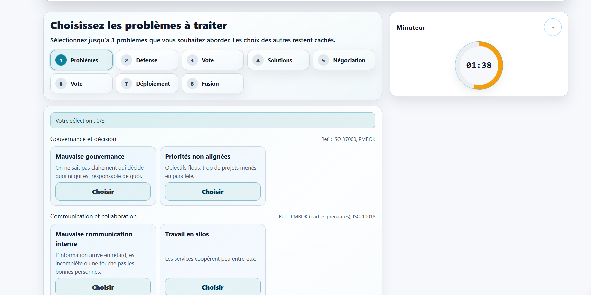
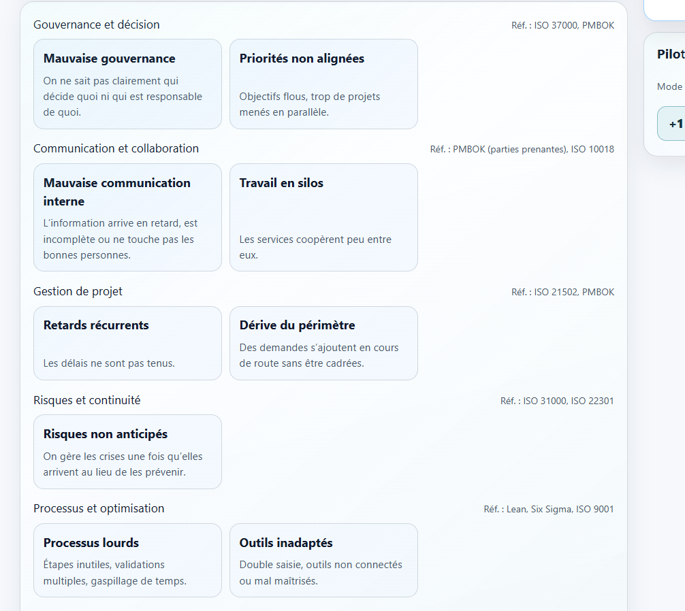

# Revue plateforme (2026-10-30, mise à jour 2026-11-07)

## 🔴 Priorité 1 — Sécurité / paiement

- [ ] Webhook Payoneer : confirmer avec la doc / le support Payoneer le format réel de la signature (en-tête, encodage hex, contenu signé) avant d'activer le webhook
  - backend/src/services/payoneer.service.js (verifyWebhookSignature)
- [ ] PR backend #4 (nodemailer 8 → 10) fusionnée : vérifications en production
  - [ ] Vérifier dans Railway que le backend tourne effectivement sur Node ≥ 20
  - [ ] Envoyer un vrai e-mail : test Brevo API en échec (`BREVO_API_SEND_FAILED`), puis SMTP rejeté (`535 EAUTH`)

## 🐞 Bugs (2026-11-06)

- [ ] Espace admin : supprimer un participant qui a rejoint par code supprime **tous** les participants
- [ ] Préférences de notification : « Impossible de charger vos préférences de notification » (les interrupteurs restent inactifs)

  

  - [x] Cause : la page est accessible aux participants, mais le backend ne sert `GET /users/me/notification-preferences` qu'aux rôles `admin` / `user` → 403. L'erreur bloquait aussi l'enregistrement des préférences d'affichage (2026-11-07)
  - [x] Correctif : section Notifications masquée pour les participants, enregistrement de l'affichage débloqué, cas participant ajouté à `test:ux:preferences-results` → PR frontend #83 (2026-11-07)
  - [ ] Relire et fusionner la PR frontend #83
  - [ ] Si l'erreur apparaît aussi avec un compte organisateur (`user`) : regarder dans l'onglet Réseau le code renvoyé par l'appel (backend local arrêté ou pas à jour ?)
  - [ ] Nettoyage local dans `frontend-next` (une fois la session du logo e-mail terminée) : `git reset --keep e3776fc` sur `fix/email-logo-cropped` (retire le commit d13ae8c ajouté par erreur), `git stash drop` du stash « WIP on fix/email-logo-cropped: e3776fc », puis `git worktree remove ..\.wt-prefs` après fusion
  - [ ] Le compte de test `manager@test.com` (rôle `manager`) reçoit un 403 sur toutes les routes `/users/me` : à supprimer ou à passer en `user`

- [ ] Workflow GitHub « Session Retention Purge » annulé chaque nuit après 6 h (depuis le 29/10) : le script termine en 2 s (`staleSessionCount: 0`) mais le process Node ne se ferme pas, la connexion Sequelize reste ouverte
  - [x] Correctif : fermeture de la connexion + `timeout-minutes: 15` → PR backend #19 fusionnée (2026-11-07)
  - [ ] Une fois GitHub Actions débloqué : lancer le workflow à la main (dry run) et vérifier qu'il finit en vert
- [ ] GitHub Actions bloqué sur le backend depuis le 2026-11-07 : « recent account payments have failed or your spending limit needs to be increased » → GitHub Settings → Billing & plans. Les PR #17, #18 et #19 ont été fusionnées sans CI : relancer la CI sur `main` une fois débloqué

## 🟠 Priorité 2 — Nettoyage technique

- [ ] Découper les fichiers géants : globals.css (~23k lignes), AdminClient.js (5,6k), socket-runtime.js (3,3k), account/page.js (2,7k), SessionBuilder.js (2,4k)
- [ ] Tests instables sur `main` : `test:ux:session-layout`, `test:ux:crossword`, `test:ux:planning` ; backend : `crossword_realtime`, `qa_smoke_flow_concurrent_participants`, `challenge-result`, `analytics-event` (passent seuls, échouent sous charge)
- [ ] Vercel « Function Storage » à 75 % du quota gratuit (10 Go) (2026-11-04) : les anciennes deployments (surtout les previews) s'accumulent, ~25 Mo de fonctions chacune
  - [x] Deployment Retention Policy de `teamblender-frontend-next` : previews / échec / annulées à 7 j, production à 14 j (les 10 dernières en prod restent conservées) (2026-11-07)
  - [ ] Vérifier vers le 2026-11-09 que la purge automatique a bien eu lieu (~150 des 284 deployments) et que Function Storage est retombé vers ~35 % ; sinon `vercel rm <url> --yes`

## 🌍 Langue arabe (AR + RTL) (2026-11-04)

PR fusionnées : frontend #55, #59, #54 / backend #11, #12. L'arabe reste masqué tant que `NEXT_PUBLIC_ENABLED_BETA_LOCALES=ar` (Vercel) / `ENABLED_BETA_LOCALES=ar` (Railway) ne sont pas définis.

- [ ] Messages d'erreur encore en français en dur : `lib/socket.js` (reconnexion), `ChallengeWrapper.js` (non connecté)
- [ ] Contenus encore en `{ fr, en }` : fiches du catalogue (`ChallengesCatalog`, `challengeCatalog`, `ChallengeConfigModal`), listes de fonctionnalités des tarifs, démo, `mockChallenges`, constantes admin
- [ ] Guides team building détaillés (`teamBuildingGuides.js`) : 404 en arabe pour l'instant ; capture d'écran arabe du héros (`copuzzle-facilitator-live-ar.webp`)
- [ ] Relecture de toutes les traductions arabes par un arabophone natif (avant activation)
- [ ] À décider : contenu arabe des challenges à texte (quiz, Pari sur moi, Mission Critique, escape room, Phrase mystère, grilles de mots croisés) → ensuite ajouter `ar` dans `challengeLocales` (frontend et backend)
- [x] Pages légales en arabe (CGU, mentions légales, politique de confidentialité, contact RGPD) : traduction complète, avec « la version française fait foi » → PR frontend #84 fusionnée. Console admin : reste en français (décidé le 2026-11-07)
- [ ] Activer la langue : variables d'environnement Vercel + Railway

## 👥 Comptes participants et e-mails

- [ ] Permettre au participant qui a été rajouté par un code de changer son adresse e-mail et son mot de passe pour les participants qui se sont connectés par le code
- [ ] E-mail envoyé au participant ajouté par le facilitateur : il doit expliquer qu'il a été ajouté comme participant à des sessions de cohésion d'équipe, et qu'il peut accéder à son compte pour changer son mot de passe et voir les sessions qui lui sont assignées
  - [x] E-mail dédié « Vous avez été ajouté(e) comme participant(e) », sans nom du manager ni de l'entreprise, bouton « Créer mon mot de passe » → PR backend #20 (2026-11-08)
  - [ ] Relire et fusionner la PR backend #20

## 🧩 Session builder

- [ ] Garder l'étape « Configurer » dans les étapes du session builder, en la signalant comme optionnelle
- [ ] Améliorer la modale du programme guidé : titre, hiérarchie, programme
- [ ] Page « Créer une session » : remarque à préciser

  

## 🔵 Challenges — contenu et gameplay

- [ ] Mission Critique, étape « Problèmes » : mettre en évidence les problèmes déjà choisis avec une autre couleur (participant et vue animateur)

  
  

- [ ] Mission Critique, desktop : afficher deux missions du backlog par ligne
- [ ] Mission Critique : analyser le challenge et réduire le nombre de phases (aujourd'hui 8 étapes ; piste : Cadrage, Planification, Jour J, Clôture)
- [ ] Pari sur moi : au départ, tous les joueurs ont une médaille à 0 point dans le classement (revue de la démo, 2026-10-31)
- [ ] Pixel Architect : le bouton « Soumettre version finale » a été retiré (frontend #80). Le timer ne s'arrête plus en avance quand tous les participants ont soumis : la partie se termine à la fin du timer ou par l'animateur. Décider si on garde ce comportement ; sinon, supprimer le handler `pixel.submit_final` devenu inutile
  - backend/src/realtime/socket-runtime.js
- [ ] Labyrinthe : tester l'équilibrage avec de vrais groupes
- [ ] Ajouter un ou deux challenges d'onboarding
- [ ] Debrief final : ajouter des scores de cohésion, leadership…
