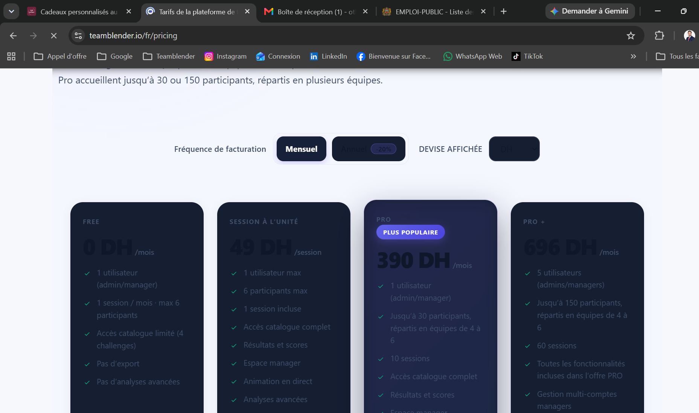
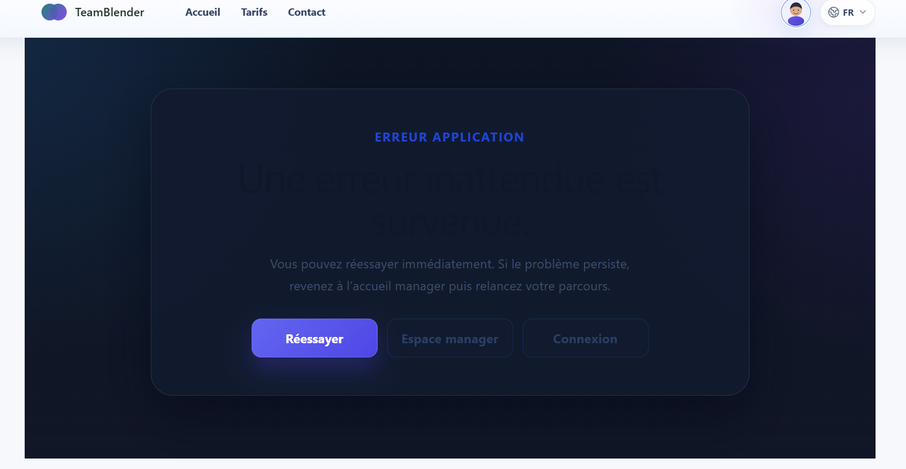

# Revue plateforme (2026-10-30)

## 🔴 Priorité 1 — Sécurité / paiement

- [ ] Webhook Payoneer : confirmer avec la doc / le support Payoneer le format réel de la signature (en-tête, encodage hex, contenu signé) avant d'activer le webhook
  - backend/src/services/payoneer.service.js (verifyWebhookSignature)
- [ ] Après le déploiement de la PR backend #4 (nodemailer 8 → 10) :
  - [ ] Vérifier dans Railway que le backend tourne effectivement sur Node ≥ 20
  - [ ] Envoyer un vrai e-mail : test Brevo API en échec (`BREVO_API_SEND_FAILED`), puis SMTP rejeté (`535 EAUTH`)

## 🟠 Priorité 2 — Nettoyage technique

- [ ] Découper les fichiers géants : globals.css (~23k lignes), AdminClient.js (5,6k), socket-runtime.js (3,3k), account/page.js (2,7k), SessionBuilder.js (2,4k)
- [ ] Workflow GitHub « Session Retention Purge » en échec chaque nuit (vu les 29, 30 et 31/10)
  - backend/.github/workflows/session-retention-purge.yml
- [ ] Vercel « Function Storage » à 75 % du quota gratuit (10 Go) (2026-11-04) : les anciennes deployments (surtout les previews) s'accumulent, ~25 Mo de fonctions chacune
  - [ ] Projet `teamblender-frontend-next` → Settings → Security → Deployment Retention Policy : previews et deployments en échec/annulées à 7–30 jours
  - [ ] Supprimer les anciennes deployments (onglet Deployments, ou `vercel ls` / `vercel rm <url> --yes`)
  - [ ] Optionnel : Ignored Build Step pour ne pas builder les commits `docs:`

## 🌍 Langue arabe (AR + RTL) (2026-11-04)

PR : phase 0 frontend #55 / backend #11, arabe (brouillons) frontend #59 / backend #12, CoPuzzle #54. L'arabe reste masqué tant que `NEXT_PUBLIC_ENABLED_BETA_LOCALES=ar` (Vercel) / `ENABLED_BETA_LOCALES=ar` (Railway) ne sont pas définis.

- [ ] Vérifier la preview Vercel de #55 en FR et EN, puis fusionner #11, #55 et #54
- [ ] Après fusion : supprimer `scripts/i18n-codemod.mjs` et la branche distante `chore/i18n-n-locales` (remplacée par `chore/i18n-locales`)
- [ ] Relecture de toutes les traductions arabes par un arabophone natif (avant activation)
- [ ] Contenus encore en `{ fr, en }` : fiches du catalogue (`ChallengesCatalog`, `challengeCatalog`, `ChallengeConfigModal`), listes de fonctionnalités des tarifs, démo, `mockChallenges`, constantes admin
- [ ] Guides team building détaillés (`teamBuildingGuides.js`) : 404 en arabe pour l'instant ; capture d'écran arabe du héros (`copuzzle-facilitator-live-ar.webp`)
- [ ] Messages d'erreur encore en français en dur : `lib/socket.js` (reconnexion), `ChallengeWrapper.js` (non connecté)
- [ ] Activer la langue : variables d'environnement Vercel + Railway
- [ ] Tests instables déjà présents sur `main` : `test:ux:session-layout`, `test:ux:crossword`, `test:ux:planning` ; backend : `crossword_realtime`, `qa_smoke_flow_concurrent_participants`, `challenge-result`, `analytics-event` (passent seuls, échouent sous charge)
- [ ] À décider : contenu arabe des challenges à texte (quiz, Pari sur moi, Mission Critique, escape room, Phrase mystère, grilles de mots croisés) → ensuite ajouter `ar` dans `challengeLocales` (frontend et backend)
- [ ] À décider : pages légales et console admin en arabe → traduction complète, ou résumé avec « la version française fait foi » (aujourd'hui : français)

## 🔵 Challenges — expérience facilitateur (revue de la démo, 2026-10-31)

- [ ] Labyrinthe : un cul-de-sac coûte une vie, en plus des pièges invisibles → tester l'équilibrage avec de vrais groupes
- [ ] Pari sur moi : au départ, tous les joueurs ont une médaille à 0 point dans le classement

