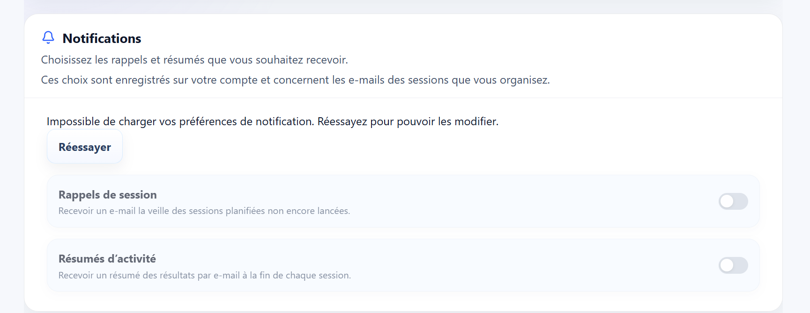
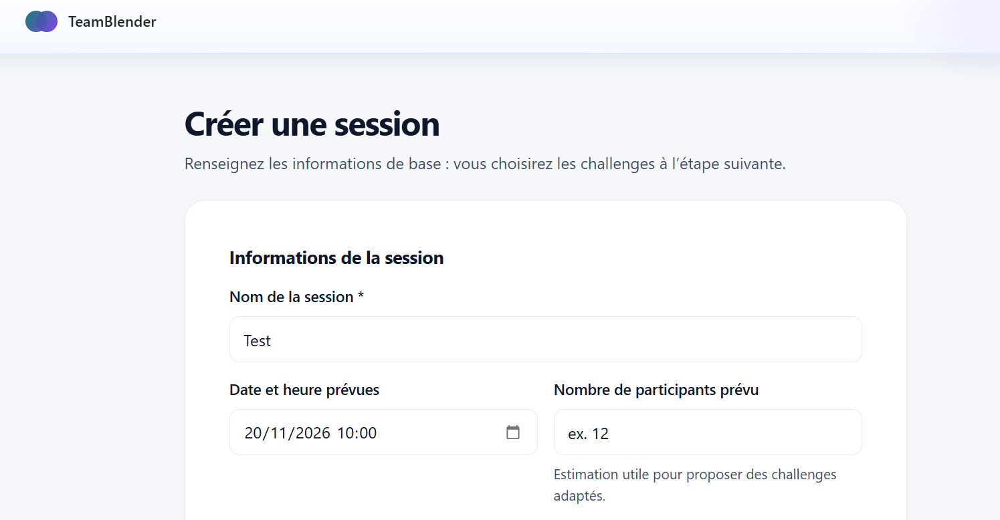

# Revue plateforme (2026-10-30, mise à jour 2026-11-07)

## 🔴 Priorité 1 — Sécurité / paiement

- [ ] Webhook Payoneer : confirmer avec la doc / le support Payoneer le format réel de la signature (en-tête, encodage hex, contenu signé) avant d'activer le webhook
  - backend/src/services/payoneer.service.js (verifyWebhookSignature)
- [ ] PR backend #4 (nodemailer 8 → 10) fusionnée : vérifications en production
  - [ ] Vérifier dans Railway que le backend tourne effectivement sur Node ≥ 20
  - [ ] Envoyer un vrai e-mail : test Brevo API en échec (`BREVO_API_SEND_FAILED`), puis SMTP rejeté (`535 EAUTH`)

## 🐞 Bugs (2026-11-06)

- [ ] Espace admin : supprimer un participant qui a rejoint par code supprime **tous** les participants
- [ ] Préférences de notification : « Impossible de charger vos préférences de notification » (les interrupteurs restent inactifs)

  

  - [ ] Relire et fusionner la PR frontend #83
  - [ ] Si l'erreur apparaît aussi avec un compte organisateur (`user`) : regarder dans l'onglet Réseau le code renvoyé par l'appel (backend local arrêté ou pas à jour ?)
  - [ ] Le compte de test `manager@test.com` (rôle `manager`) reçoit un 403 sur toutes les routes `/users/me` : à supprimer ou à passer en `user`

- [ ] Workflow GitHub « Session Retention Purge » annulé chaque nuit après 6 h (depuis le 29/10) : le script termine en 2 s (`staleSessionCount: 0`) mais le process Node ne se ferme pas, la connexion Sequelize reste ouverte
  - [ ] Une fois GitHub Actions débloqué : lancer le workflow à la main (dry run) et vérifier qu'il finit en vert
- [ ] GitHub Actions bloqué sur le backend depuis le 2026-11-07 : « recent account payments have failed or your spending limit needs to be increased » → GitHub Settings → Billing & plans. Les PR #17, #18 et #19 ont été fusionnées sans CI : relancer la CI sur `main` une fois débloqué

## 🟠 Priorité 2 — Nettoyage technique

- [ ] Découper les fichiers géants : globals.css (~23k lignes), AdminClient.js (5,6k), socket-runtime.js (3,3k), account/page.js (2,7k), SessionBuilder.js (2,4k)
- [ ] Vercel « Function Storage » à 75 % du quota gratuit (10 Go) (2026-11-04) : les anciennes deployments (surtout les previews) s'accumulent, ~25 Mo de fonctions chacune
  - [ ] Vérifier vers le 2026-11-09 que la purge automatique a bien eu lieu (~150 des 284 deployments) et que Function Storage est retombé vers ~35 % ; sinon `vercel rm <url> --yes`

## 🌍 Langue arabe (AR + RTL) (2026-11-04)

PR fusionnées : frontend #55, #59, #54 / backend #11, #12. L'arabe reste masqué tant que `NEXT_PUBLIC_ENABLED_BETA_LOCALES=ar` (Vercel) / `ENABLED_BETA_LOCALES=ar` (Railway) ne sont pas définis.

- [ ] Console admin : les champs de règles affichés dans l'édition ne sont pas inclus dans la sauvegarde ; `engine_config.rules` est aussi retiré avant l'envoi. Décider si ces champs doivent être persistés ou rendus non éditables
- [ ] Relecture de toutes les traductions arabes par un arabophone natif (avant activation)
- [ ] Ajouter et tester les contenus arabes du quiz et de Mission Critique, puis adapter l'escape room, Phrase mystère et les grilles de mots croisés ; activer chaque moteur dans les deux `challengeLocales` après validation
  - [ ] Adapter les énigmes historiques de la première escape room et vérifier les réponses et interfaces RTL
  - [ ] Créer des grilles arabes et adapter leur orientation, saisie et interface RTL
  - [ ] Tester les parcours complets en arabe, faire relire les contenus par un arabophone et activer les moteurs validés dans les deux registres
- [ ] Activer la langue : variables d'environnement Vercel + Railway

## 👥 Comptes participants et e-mails

- [ ] Permettre au participant qui a été rajouté par un code de changer son adresse e-mail et son mot de passe pour les participants qui se sont connectés par le code

## 🧩 Session builder

- [ ] Garder l'étape « Configurer » dans les étapes du session builder, en la signalant comme optionnelle
- [ ] Améliorer la modale du programme guidé : titre, hiérarchie, programme
- [ ] Page « Créer une session » : remarque à préciser

  

## 🔵 Challenges — contenu et gameplay

- [ ] Concevoir et tester un atelier d'accueil d'équipe court, sans préparation
- [ ] Debrief final : ajouter des scores de cohésion, leadership…

## Business model

Prompt 0 — Contexte et règles (à coller en premier)
Contexte : TeamBlender (teamblender.io) est un SaaS B2B de cohésion d'équipe. Des défis collaboratifs de 15 à 35 min, joués en direct dans le navigateur, conçus pour des groupes d'environ 5 personnes. Site en français, anglais et arabe (RTL).

On change de business model :
- On facture au nombre de PARTICIPANTS, jamais au nombre de sessions. Sessions illimitées sur toutes les offres.
- 3 offres : Essai (gratuit 30 jours, 20 participants max, tous les défis), Équipe (29 €/mois en annuel ou 39 €/mois au mois, 1 équipe de 25 participants max), Entreprise (sur devis, à partir de 1 800 €/an, facturation annuelle par virement).
- On supprime : le paiement à la session (5 $), les quotas de sessions, l'ancienne grille Gratuit / Pro / Pro+ en dollars.
- Pas de paiement par carte (Stripe indisponible au Maroc) : les offres payantes sont activées à la main par l'admin après virement.

Règles :
1. Avant de modifier quoi que ce soit, explore le code et donne-moi un résumé : stack, où sont définies les offres et les limites, où sont vérifiés les quotas de sessions, où est la page tarifs, où est le paiement, comment fonctionnent les sessions et les participants. N'écris aucun code à cette étape.
2. Ensuite, changements minimaux : le produit est en phase de validation, je ne veux casser aucun parcours existant (créer une session, rejoindre une session, jouer, voir les indicateurs).
3. Ne supprime pas de données en base. Les comptes existants doivent continuer de fonctionner.
4. Pour chaque étape, liste les fichiers modifiés et dis-moi comment tester à la main.
Prompt 1 — Centraliser les offres et supprimer les quotas de sessions
Crée une configuration unique des offres (un seul fichier ou une seule table, selon la stack) avec, pour chaque offre : identifiant (trial, team, enterprise), nom affiché FR/EN/AR, limite de participants, durée (30 jours pour trial), prix affiché.

- trial : 20 participants, 30 jours, tous les défis débloqués.
- team : 25 participants, sessions illimitées.
- enterprise : limite de participants personnalisable par compte (champ modifiable par l'admin), sessions illimitées.

Remplace toutes les vérifications de quota de sessions par une vérification de limite de participants uniquement. Supprime l'offre « paiement à la session » de l'interface.

Définition de la limite : nombre de participants distincts dans l'équipe (la liste des membres du compte), PAS par session. Exemple : une équipe de 20 personnes qui joue en 4 sessions de 5 compte pour 20, pas pour 4 × 5 à chaque session.

Migration des comptes existants : les comptes gratuits actuels passent en trial avec 30 jours à partir d'aujourd'hui ; les comptes Pro/Pro+ éventuels passent en team ou enterprise sans perte d'accès. Montre-moi le plan de migration avant de l'exécuter.
Prompt 2 — Dupliquer une session (équipes de plus de 5)
Problème : un manager de 20 personnes doit aujourd'hui créer 4 sessions à la main pour faire jouer 4 groupes de 5.

Ajoute une action « Dupliquer » sur une session (dans la liste des sessions et sur la page de la session) :
- La copie reprend le même défi, les mêmes réglages, la même date et heure.
- Le nom reçoit un suffixe : « [nom] — Groupe 2 », « Groupe 3 »…
- La liste des participants de la copie est vide, et l'utilisateur arrive directement sur l'écran d'édition des participants de la copie.
- Option : un champ « Nombre de copies » (1 à 9) pour créer plusieurs groupes d'un coup.

Préparer l'avenir : ajoute aux sessions un champ optionnel qui relie l'original et ses copies (par exemple event_group_id). Toutes les copies et l'original partagent la même valeur. Pas d'interface pour l'instant : ça servira plus tard à un classement commun.

La duplication ne doit pas consommer de quota (il n'y en a plus) et respecte la limite de participants de l'équipe.

Libellés en FR / EN / AR (RTL correct pour l'arabe).
Prompt 3 — Nouvelle page tarifs (FR / EN / AR)
Refais la page tarifs avec 3 cartes, en lisant les données depuis la configuration des offres créée au prompt 1 :

1. Essai — « Gratuit pendant 30 jours » — jusqu'à 20 participants, tous les défis, sans carte bancaire. Bouton : « Commencer l'essai ».
2. Équipe — « 29 €/mois, facturé annuellement » (mention secondaire : « ou 39 € au mois ») — 1 équipe jusqu'à 25 participants, sessions illimitées, indicateurs de participation. Bouton : « Demander l'activation ».
3. Entreprise — « À partir de 150 €/mois, facturation annuelle » — plusieurs équipes et sites, tableau de bord par site, première session animée avec vous, facture annuelle par virement. Bouton : « Demander une démo ». Mettre cette carte en avant (badge « Multi-sites »).

Sous les cartes : une ligne « Sessions illimitées sur toutes les offres. Un défi se joue par groupes d'environ 5 : une équipe de 20 joue en 4 groupes, sans surcoût. »

Supprime toute mention de sessions comptées, du paiement à la session et des prix en dollars, partout sur le site (accueil, FAQ, emails si présents).

Traductions EN et AR complètes, mise en page RTL vérifiée en arabe, affichage correct sur mobile.
Prompt 4 — Remplacer le paiement par une demande d'activation
Il n'y a pas de paiement par carte. Remplace tout bouton ou parcours de paiement par un formulaire « Demander l'activation / une démo » avec : nom, email professionnel, entreprise, offre souhaitée (Équipe / Entreprise), nombre de personnes, pays des équipes (cases : Maroc, France, Autre), message.

À l'envoi : enregistre la demande en base et envoie-moi un email de notification (utilise le système d'email existant ; s'il n'y en a pas, enregistre seulement en base et dis-le-moi). Affiche à l'utilisateur : « Merci, nous revenons vers vous sous 24 h. »

Ne collecte aucune donnée bancaire.
Prompt 5 — Activation manuelle par l'admin (peut attendre)
Ajoute un écran admin (accès réservé à mon compte) pour chaque compte client :
- choisir l'offre (trial, team, enterprise),
- modifier la limite de participants (enterprise),
- définir une date de fin d'accès (pilote, essai prolongé, licence annuelle),
- voir la liste des demandes d'activation reçues (prompt 4).

Quand la date de fin est dépassée : l'utilisateur garde l'accès en lecture à ses indicateurs mais ne peut plus lancer de session, avec un message « Votre accès est terminé — demandez l'activation » et le bouton vers le formulaire.
Prompt 6 — Vérification finale (à faire après chaque série)
Fais une vérification complète :
1. Liste tous les endroits où les mots session/quota/5 $/Pro/Pro+ apparaissent encore dans l'interface ou les traductions.
2. Lance les tests existants et dis-moi ce qui casse.
3. Donne-moi un scénario de test manuel : créer un compte d'essai → créer une session → la dupliquer 3 fois → mettre 5 participants dans chacune → vérifier que la limite de 20 est respectée → essayer d'ajouter un 21e participant → vérifier le message.
4. Vérifie la page tarifs en FR, EN et AR (RTL) sur mobile.