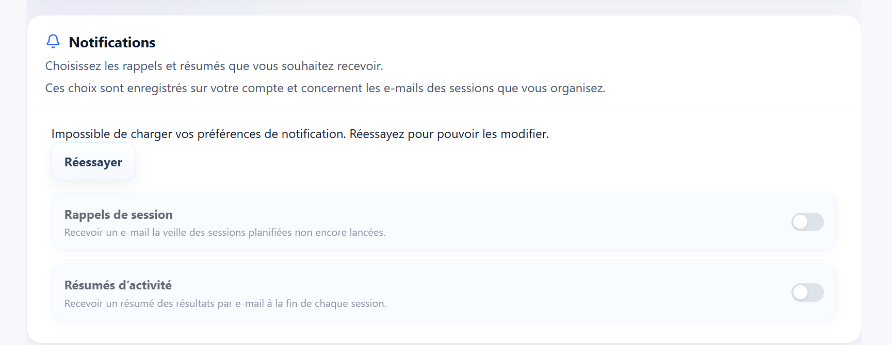
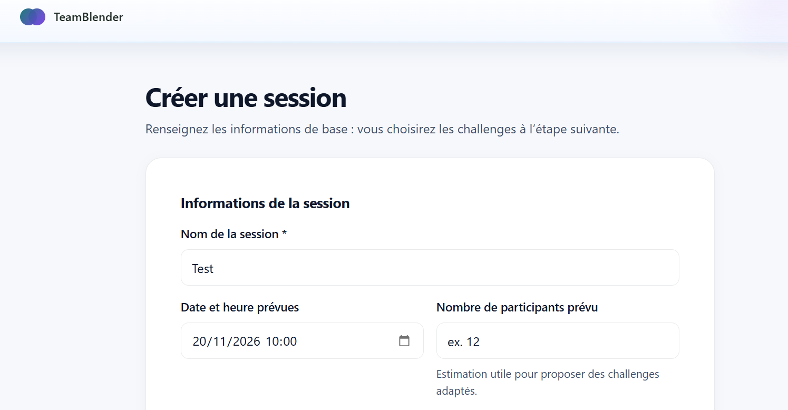

# Revue plateforme (2026-10-30, mise à jour 2026-11-25)

## 🔴 Priorité 1 — Sécurité / paiement

- [ ] Webhook Payoneer : confirmer avec la doc / le support Payoneer le format réel de la signature (en-tête, encodage hex, contenu signé) avant d'activer le webhook
  - backend/src/services/payoneer.service.js (verifyWebhookSignature)
- [ ] PR backend #4 (nodemailer 8 → 10) fusionnée : vérifications en production
  - [ ] Vérifier dans Railway que le backend tourne effectivement sur Node ≥ 20
  - [ ] Envoyer un vrai e-mail : test Brevo API en échec (`BREVO_API_SEND_FAILED`), puis SMTP rejeté (`535 EAUTH`)

- [ ] Facturation en MAD à 0 (2026-11-24) : les trois formules de base (Essai, Essentiel, Organisation) ont `price_mad_cents = 0` (valeur par défaut, non renseignée par `npm run pricing:seed`). Or `getPlanCharge` (backend/src/services/billing-admin.service.js) et le lien de paiement (backend/src/controllers/billing.controller.js) lisent ce champ en priorité : un paiement manuel ou un lien de paiement pour Essentiel risque d'être calculé à 0 MAD au lieu de 39 €
  - [ ] Vérifier `price_mad_cents` / `annual_price_mad_cents` des formules en production
  - [ ] Décider de la devise qui fait foi (EUR ou MAD), puis renseigner les prix MAD si le MAD doit primer
  - [x] Branche backend `claude/peaceful-cray-vw09c4` (2026-11-25) : `price_mad_cents` à 0 n'est plus lu, on reprend le prix EUR de la formule (annuel compris) ; le lien PayPal utilise le même calcul
  - [x] Test sur `getPlanCharge` avec une formule de base (backend #45, fusionnée)
  - [ ] Après déploiement du backend #45 : un lien de paiement ou un paiement manuel Essentiel doit afficher 39 € (374 € en annuel), plus 0 MAD

## 🐞 Bugs (2026-11-06)

- [ ] Espace admin : supprimer un participant qui a rejoint par code supprime **tous** les participants
  - Non reproduit le 2026-11-25 sur `main` : l'API ne supprime que le participant visé (test de non-régression ajouté côté backend). Si le problème réapparaît : noter le compte, la page (console admin ou accueil manager) et le participant concernés
- [ ] Préférences de notification : « Impossible de charger vos préférences de notification » (les interrupteurs restent inactifs)

  

  - [x] Relire et fusionner la PR frontend #83 (fusionnée)
  - [ ] Si l'erreur apparaît aussi avec un compte organisateur (`user`) : regarder dans l'onglet Réseau le code renvoyé par l'appel (backend local arrêté ou pas à jour ?)
  - [ ] Le compte de test `manager@test.com` (rôle `manager`) reçoit un 403 sur toutes les routes `/users/me` : à supprimer ou à passer en `user` en base (le script `seed_users.js` le crée désormais en `user`)

- [ ] Workflow GitHub « Session Retention Purge » annulé chaque nuit après 6 h (depuis le 29/10) : le script termine en 2 s (`staleSessionCount: 0`) mais le process Node ne se ferme pas, la connexion Sequelize reste ouverte
  - [x] Correctif présent sur `main` : le script ferme la connexion et sort (moins d'une seconde en local, 2026-11-25)
  - [ ] Une fois GitHub Actions débloqué : lancer le workflow à la main (dry run) et vérifier qu'il finit en vert
- [ ] GitHub Actions bloqué sur le backend depuis le 2026-11-07 : « recent account payments have failed or your spending limit needs to be increased » → GitHub Settings → Billing & plans. Les PR #17, #18, #19, #45 et #46 ont été fusionnées sans CI (tests passés en local) : relancer la CI sur `main` une fois débloqué

## 🟠 Priorité 2 — Nettoyage technique

- [x] Tests frontend en échec sur `main` (constaté le 2026-11-24) : `test-home-session-filters` et `test-contact-ux` cherchent un bouton « Refuser les cookies de mesure » qui n'existe plus ; `test:smoke:seo` attend un ancien texte de FAQ. `npm run check:typography`, demandé par le modèle de PR, n'existe pas
  - Corrigé le 2026-11-25 (branche frontend `claude/peaceful-cray-vw09c4`) : bandeau cookies fermé seulement s'il s'affiche, tests contact et SEO à jour, script `check:typography` ajouté
- [x] Politique de confidentialité : la phrase « uniquement des cookies strictement nécessaires » contredit PostHog et GTM (déposés après consentement) : à reformuler (texte FR/EN/AR réécrit le 2026-11-25 ; la version arabe est à faire relire avec les autres traductions)
- [ ] Découper les fichiers géants : globals.css (~23k lignes), AdminClient.js (5,6k), socket-runtime.js (3,3k), account/page.js (2,7k), SessionBuilder.js (2,4k)
  - [x] AdminClient.js : 4 275 → 2 693 lignes, onglets dans app/admin/tabs/ (frontend #119)
  - [x] account/page.js : 2 249 → 852 lignes, CSS dans account.css et onglets en composants (frontend #120)
  - [x] SessionBuilder.js : 2 092 → 1 668 lignes, écran de création et fenêtres en composants (frontend #121)
  - [x] socket-runtime.js : 3 338 → 2 505 lignes, six modules de helpers, après une trace de référence des événements temps réel (backend #46)
  - [x] globals.css : déjà découpé en 23 tranches (app/styles/) ; 767 règles de CSS mort retirées, 23 769 → 18 751 lignes (frontend #122)
  - [ ] Suite possible : l'aiguillage handleChallengeEvent de socket-runtime.js (~1 500 lignes) et la logique de SessionBuilder.js (hooks)
  - [ ] Après déploiement du backend #46 : une session de test par jeu (rejoindre, quelques actions, fin du chrono) et contrôle des logs Railway
  - [ ] Après déploiement du frontend #122 (CSS mort retiré) : tour rapide en thème sombre, sur mobile et desktop, surtout les jeux en direct (non couverts par la comparaison automatique, faite sans partie en cours)
- [x] Code mort repéré pendant le découpage : retiré (frontend #126, 2026-11-27)
  - [x] `app/admin/AdminClient.js` : bouton 🔑 « Réinitialiser le mot de passe » ajouté dans les onglets Utilisateurs et Participants
  - [x] `app/account/page.js` : `handleChangePlan` et tout ce qui ne servait qu'à lui retirés, textes orphelins compris
  - [x] `app/session-builder/SessionBuilder.js` : états et variables inutilisés retirés
  - [ ] Après déploiement du frontend #126 : réinitialiser un mot de passe de test depuis la console admin (champ vide, puis mot de passe saisi)
- [ ] Tests et outillage
  - [ ] Lancer une fois toute la suite `npm run test:ux:*` du frontend : seuls les scripts touchés le 2026-11-25 ont été relancés (plusieurs étaient cassés sur `main` depuis des changements de produit)
  - [ ] Ajouter `npm run check:typography` à la CI frontend (`.github/workflows/ci.yml`), aujourd'hui lancé seulement à la main
  - [ ] Étendre la trace de référence temps réel (`tests/realtime_event_trace.test.js`) au quiz et aux mots croisés, qui n'ont que leurs tests dédiés
- [ ] Vercel « Function Storage » à 75 % du quota gratuit (10 Go) (2026-11-04) : les anciennes deployments (surtout les previews) s'accumulent, ~25 Mo de fonctions chacune
  - [ ] Vérifier vers le 2026-11-09 que la purge automatique a bien eu lieu (~150 des 284 deployments) et que Function Storage est retombé vers ~35 % ; sinon `vercel rm <url> --yes`

## 🌍 Langue arabe (AR + RTL) (2026-11-04)

PR fusionnées : frontend #55, #59, #54 / backend #11, #12. L'arabe reste masqué tant que `NEXT_PUBLIC_ENABLED_BETA_LOCALES=ar` (Vercel) / `ENABLED_BETA_LOCALES=ar` (Railway) ne sont pas définis.

- [ ] Console admin : les champs de règles affichés dans l'édition ne sont pas inclus dans la sauvegarde ; `engine_config.rules` est aussi retiré avant l'envoi. Décider si ces champs doivent être persistés ou rendus non éditables
- [ ] Relecture de toutes les traductions arabes par un arabophone natif (avant activation)
- [ ] Ajouter et tester les contenus arabes du quiz et de Mission Critique, puis adapter l'escape room, Phrase mystère et les grilles de mots croisés ; activer chaque moteur dans les deux `challengeLocales` après validation
  - [ ] Adapter les énigmes historiques de la première escape room et vérifier les réponses et interfaces RTL
  - [ ] Créer des grilles arabes et adapter leur orientation, saisie et interface RTL
  - [ ] Tester les parcours complets en arabe, faire relire les contenus par un arabophone et activer les moteurs validés dans les deux registres
- [ ] Activer la langue : variables d'environnement Vercel + Railway

## 👥 Comptes participants et e-mails

- [ ] Permettre au participant qui a été rajouté par un code de changer son adresse e-mail et son mot de passe pour les participants qui se sont connectés par le code

## 🧩 Session builder

- [ ] Garder l'étape « Configurer » dans les étapes du session builder, en la signalant comme optionnelle
- [ ] Améliorer la modale du programme guidé : titre, hiérarchie, programme
- [ ] Page « Créer une session » : remarque à préciser

  

## 🔵 Challenges — contenu et gameplay

- [ ] Concevoir et tester un atelier d'accueil d'équipe court, sans préparation
- [ ] Debrief final : ajouter des scores de cohésion, leadership…

## 📈 Visibilité, indexation et mesure (2026-11-24)

Constat : Ahrefs donne une autorité de domaine de 0/100 (aucun lien entrant) et le site n'apparaît pas sur Google, même pour la requête « TeamBlender » (seuls des résultats sur Blender 3D). Les visites ne viennent que de la prospection : la priorité reste les relances et les démos, ces actions sont plafonnées à 2 h par semaine.

### Site public : finir la PR frontend #116

- [ ] Preview Vercel de la PR, en FR et EN, clair et sombre, mobile et desktop :
  - [ ] `/fr` : section « Pour qui » avec 3 cartes (RH, manager, coach/formateur/Scrum Master), textes lisibles en thème sombre
  - [ ] `/en/demo` : le compteur affiche « Showing 2 of 2 sessions », le filtre Période a une flèche (plus de « Period+ »)
  - [ ] Pied de page : `contact@teamblender.io` cliquable, lien LinkedIn vers la page publique
  - [ ] `/en/politique-confidentialite` redirige vers `/en/confidentialite`
- [ ] Parcours manager (login → accueil → session builder) et participant (rejoindre → défi en cours) sur la preview, comme le demande le modèle de PR
- [ ] Approuver et fusionner la PR, puis refaire un contrôle rapide en production
- [ ] Démo : la bulle d'aide bleue (« Hide tips ») recouvre le filtre Dates sur desktop (vu le 2026-11-24)

### Offre d'essai : aligner les documents

- [ ] Décision confirmée le 2026-11-24 : l'essai donne jusqu'à 20 participants et 5 sessions au total, et une session est idéalement prévue pour 4 participants. La page Tarifs est juste. Le prompt « Business model » plus bas parle encore de sessions illimitées et de groupes d'environ 5 : le mettre à jour pour ne plus le signaler comme un écart

### Plausible (mesure d'audience sans cookie) : la connexion ne marche pas encore

- [ ] Fusionner la PR frontend #116 (elle ajoute le script Plausible) : tant qu'elle n'est pas en production, Plausible ne peut rien détecter
- [ ] Vercel → Settings → Environment Variables : `NEXT_PUBLIC_PLAUSIBLE_DOMAIN=teamblender.io` en Production, puis redéployer sans cache (la variable est lue au build)
- [ ] Le domaine déclaré dans Plausible doit être exactement `teamblender.io` (sans `www`, sans `https://`)
- Si ça ne marche toujours pas, dans cet ordre :
  - [ ] Ouvrir https://teamblender.io/pa/script.js : du JavaScript (200) est attendu. 404 = la PR n'est pas déployée ; 500 = le relais vers plausible.io échoue (voir les logs Vercel)
  - [ ] Afficher le code source de la page d'accueil et chercher `plausible-analytics` : absent = la variable n'a pas été prise au build (redéployer)
  - [ ] Onglet Réseau du navigateur sur une page publique : `POST /pa/api/event` doit répondre 202
  - [ ] Tester sur une page publique (`/fr`, `/fr/pricing`), pas sur `/home` ni les espaces participant ou admin (exclus volontairement), avec le bloqueur de publicités désactivé
  - [ ] Le bouton « Verify installation » de Plausible peut échouer avec un script relayé : se fier au tableau de bord en temps réel
  - [ ] Si le compte Plausible impose un script personnalisé (`pa-XXXX.js` avec `plausible.init()`), transmettre le snippet fourni pour adapter le relais `/pa/*`

### Indexation Google et Bing (semaine 1, environ 1 h)

Version canonique du site : `https://www.teamblender.io` (avec `www`). Depuis le 2026-11-25, `teamblender.io` redirige en 308 vers `www` dans Vercel (vérifié en production).

- [ ] Google Search Console : créer une propriété de type « Domaine » `teamblender.io` (enregistrement TXT chez le registraire DNS ; elle couvre `www` et la version sans www), puis soumettre `https://www.teamblender.io/sitemap.xml` (38 URL : 19 pages en FR et en EN)
- [ ] Inspection d'URL → « Demander l'indexation » pour les pages principales : `/fr`, `/en`, `/fr/pricing`, `/fr/defis`, `/en/team-challenges`, `/fr/team-building`, `/en/team-building/remote`, `/en/team-building/hybrid`
- [ ] Bing Webmaster Tools : importer le site depuis Search Console (alimente aussi DuckDuckGo et la recherche de ChatGPT) et soumettre le même sitemap. Le fichier de vérification `BingSiteAuth.xml` est déjà servi par le frontend
- [ ] Une semaine après : rapport « Pages » de Search Console, vérifier qu'aucune page publique n'est exclue par erreur (noindex, robots, redirection). Les anciennes URL `/en/team-building/a-distance` et `/en/team-building/hybride` redirigent en 308 vers `/remote` et `/hybrid` : c'est attendu
- [ ] Après indexation : tester `site:teamblender.io`, puis « TeamBlender team building » et « escape game en ligne entreprise »
- [x] Une seule version du site : `teamblender.io` → `www.teamblender.io` en 308 (2026-11-25)

### SEO et référencement IA : suite de l'audit du 2026-11-25

Fait le 2026-11-25 (frontend #123 et #124, en production) : offres balisées sur `/pricing`, URL anglaises traduites, image de partage par langue, `llms.txt` avec faits clés, offres et défis, un seul H1 sur `/demo`, catalogue public des 10 défis (`/fr/defis`, `/en/team-challenges`) relié au menu, au pied de page et à l'accueil.

- [ ] Contrôle en production après #123 et #124 : parcours manager (login → accueil → session builder) et participant (rejoindre → défi en cours), en FR et EN, clair et sombre, mobile et desktop. Non fait sur la preview
- [ ] Faire relire la version arabe du catalogue des défis (`lib/i18n/dictionaries/ar/challengeCatalog.js`) avec les autres traductions arabes
- [ ] Une fois les fiches Capterra, G2, Product Hunt ou Crunchbase créées (voir « Premiers liens entrants ») : ajouter leurs URL au `sameAs` du bloc `Organization` (`lib/structuredData.js`) ; aujourd'hui seule la page LinkedIn y figure
- [ ] Page « À propos » : qui est derrière TeamBlender, où, depuis quand, entité juridique. Les moteurs de réponse IA s'appuient sur ces faits pour citer une marque
- [ ] Guides plus longs (plus de 1 200 mots, contre environ 520 aujourd'hui) avec une réponse directe sous le H1 : idées de team building à distance, brise-glace en réunion, team building gratuit, séminaire
- [ ] Décider si le H1 de l'accueil doit contenir « team building » (aujourd'hui « Créez de la cohésion dans vos équipes hybrides ou distribuées », alors que le titre de la page cible « team building »)
- [ ] Performance : les pages publiques ne sont jamais mises en cache (`cache-control: private, no-store`, le layout lit `headers()`), et l'accueil charge environ 1,4 Mo de JavaScript non compressé. Chantier : pages publiques statiques avec revalidation (ISR) via un segment `[locale]`, sections statiques de l'accueil en composants serveur
- [ ] GitHub : supprimer les branches frontend `claude/blissful-wozniak-p0hpij`, `feature/seo-geo-quick-wins` et `feature/challenge-catalog` (PR fusionnées ; la session Claude n'a pas pu les supprimer)

### Requête de marque « TeamBlender » (se distinguer de Blender 3D)

- [ ] Page LinkedIn entreprise : renseigner le site web `https://www.teamblender.io`, la description et le logo (elle est déjà déclarée dans les données structurées du site)
- [ ] Écrire « TeamBlender » associé à « team building » ou « cohésion d'équipe » partout (signature e-mail, LinkedIn, annuaires)

### Premiers liens entrants (gratuits, au nom de TeamBlender, contact@teamblender.io)

- [ ] Fiches dans des annuaires SaaS : Capterra (couvre aussi GetApp et Software Advice), G2, SaaSworthy, AlternativeTo, SaaSHub, Crunchbase
- [ ] Préparer un lancement Product Hunt (visuels, description, premier commentaire)
- [ ] Demander aux coachs et formateurs partenaires un lien vers TeamBlender depuis leur site (page ressources ou outils)
- [ ] Pages « Alternative à QuizBreaker » et « Alternative à Water Cooler Trivia », sur le modèle des guides team building existants (à développer)
- [ ] Page LinkedIn TeamBlender : un post par semaine (extraits de sessions, idées de rituels)

### Suivi

- [ ] Ajouter des paramètres UTM aux liens des relances (`?utm_source=email&utm_campaign=relance-novembre`) pour voir dans Plausible quelles relances génèrent des visites
- [ ] Chaque semaine : visites et sources dans Plausible. Chaque mois : pages indexées (Search Console) et autorité de domaine (Ahrefs, outil gratuit)

## Business model

Prompt 0 — Contexte et règles (à coller en premier)
Contexte : TeamBlender (teamblender.io) est un SaaS B2B de cohésion d'équipe. Des défis collaboratifs de 15 à 35 min, joués en direct dans le navigateur, conçus pour des groupes d'environ 5 personnes. Site en français, anglais et arabe (RTL).

On change de business model :
- On facture au nombre de PARTICIPANTS, jamais au nombre de sessions. Sessions illimitées sur toutes les offres.
- 3 offres : Essai (gratuit 30 jours, 20 participants max, tous les défis), Équipe (29 €/mois en annuel ou 39 €/mois au mois, 1 équipe de 25 participants max), Entreprise (sur devis, à partir de 1 800 €/an, facturation annuelle par virement).
- On supprime : le paiement à la session (5 $), les quotas de sessions, l'ancienne grille Gratuit / Pro / Pro+ en dollars.
- Pas de paiement par carte (Stripe indisponible au Maroc) : les offres payantes sont activées à la main par l'admin après virement.

Règles :
1. Avant de modifier quoi que ce soit, explore le code et donne-moi un résumé : stack, où sont définies les offres et les limites, où sont vérifiés les quotas de sessions, où est la page tarifs, où est le paiement, comment fonctionnent les sessions et les participants. N'écris aucun code à cette étape.
2. Ensuite, changements minimaux : le produit est en phase de validation, je ne veux casser aucun parcours existant (créer une session, rejoindre une session, jouer, voir les indicateurs).
3. Ne supprime pas de données en base. Les comptes existants doivent continuer de fonctionner.
4. Pour chaque étape, liste les fichiers modifiés et dis-moi comment tester à la main.
Prompt 1 — Centraliser les offres et supprimer les quotas de sessions
Crée une configuration unique des offres (un seul fichier ou une seule table, selon la stack) avec, pour chaque offre : identifiant (trial, team, enterprise), nom affiché FR/EN/AR, limite de participants, durée (30 jours pour trial), prix affiché.

- trial : 20 participants, 30 jours, tous les défis débloqués.
- team : 25 participants, sessions illimitées.
- enterprise : limite de participants personnalisable par compte (champ modifiable par l'admin), sessions illimitées.

Remplace toutes les vérifications de quota de sessions par une vérification de limite de participants uniquement. Supprime l'offre « paiement à la session » de l'interface.

Définition de la limite : nombre de participants distincts dans l'équipe (la liste des membres du compte), PAS par session. Exemple : une équipe de 20 personnes qui joue en 4 sessions de 5 compte pour 20, pas pour 4 × 5 à chaque session.

Migration des comptes existants : les comptes gratuits actuels passent en trial avec 30 jours à partir d'aujourd'hui ; les comptes Pro/Pro+ éventuels passent en team ou enterprise sans perte d'accès. Montre-moi le plan de migration avant de l'exécuter.
Prompt 2 — Dupliquer une session (équipes de plus de 5)
Problème : un manager de 20 personnes doit aujourd'hui créer 4 sessions à la main pour faire jouer 4 groupes de 5.

Ajoute une action « Dupliquer » sur une session (dans la liste des sessions et sur la page de la session) :
- La copie reprend le même défi, les mêmes réglages, la même date et heure.
- Le nom reçoit un suffixe : « [nom] — Groupe 2 », « Groupe 3 »…
- La liste des participants de la copie est vide, et l'utilisateur arrive directement sur l'écran d'édition des participants de la copie.
- Option : un champ « Nombre de copies » (1 à 9) pour créer plusieurs groupes d'un coup.

Préparer l'avenir : ajoute aux sessions un champ optionnel qui relie l'original et ses copies (par exemple event_group_id). Toutes les copies et l'original partagent la même valeur. Pas d'interface pour l'instant : ça servira plus tard à un classement commun.

La duplication ne doit pas consommer de quota (il n'y en a plus) et respecte la limite de participants de l'équipe.

Libellés en FR / EN / AR (RTL correct pour l'arabe).
Prompt 3 — Nouvelle page tarifs (FR / EN / AR)
Refais la page tarifs avec 3 cartes, en lisant les données depuis la configuration des offres créée au prompt 1 :

1. Essai — « Gratuit pendant 30 jours » — jusqu'à 20 participants, tous les défis, sans carte bancaire. Bouton : « Commencer l'essai ».
2. Équipe — « 29 €/mois, facturé annuellement » (mention secondaire : « ou 39 € au mois ») — 1 équipe jusqu'à 25 participants, sessions illimitées, indicateurs de participation. Bouton : « Demander l'activation ».
3. Entreprise — « À partir de 150 €/mois, facturation annuelle » — plusieurs équipes et sites, tableau de bord par site, première session animée avec vous, facture annuelle par virement. Bouton : « Demander une démo ». Mettre cette carte en avant (badge « Multi-sites »).

Sous les cartes : une ligne « Sessions illimitées sur toutes les offres. Un défi se joue par groupes d'environ 5 : une équipe de 20 joue en 4 groupes, sans surcoût. »

Supprime toute mention de sessions comptées, du paiement à la session et des prix en dollars, partout sur le site (accueil, FAQ, emails si présents).

Traductions EN et AR complètes, mise en page RTL vérifiée en arabe, affichage correct sur mobile.
Prompt 4 — Remplacer le paiement par une demande d'activation
Il n'y a pas de paiement par carte. Remplace tout bouton ou parcours de paiement par un formulaire « Demander l'activation / une démo » avec : nom, email professionnel, entreprise, offre souhaitée (Équipe / Entreprise), nombre de personnes, pays des équipes (cases : Maroc, France, Autre), message.

À l'envoi : enregistre la demande en base et envoie-moi un email de notification (utilise le système d'email existant ; s'il n'y en a pas, enregistre seulement en base et dis-le-moi). Affiche à l'utilisateur : « Merci, nous revenons vers vous sous 24 h. »

Ne collecte aucune donnée bancaire.
Prompt 5 — Activation manuelle par l'admin (peut attendre)
Ajoute un écran admin (accès réservé à mon compte) pour chaque compte client :
- choisir l'offre (trial, team, enterprise),
- modifier la limite de participants (enterprise),
- définir une date de fin d'accès (pilote, essai prolongé, licence annuelle),
- voir la liste des demandes d'activation reçues (prompt 4).

Quand la date de fin est dépassée : l'utilisateur garde l'accès en lecture à ses indicateurs mais ne peut plus lancer de session, avec un message « Votre accès est terminé — demandez l'activation » et le bouton vers le formulaire.
Prompt 6 — Vérification finale (à faire après chaque série)
Fais une vérification complète :
1. Liste tous les endroits où les mots session/quota/5 $/Pro/Pro+ apparaissent encore dans l'interface ou les traductions.
2. Lance les tests existants et dis-moi ce qui casse.
3. Donne-moi un scénario de test manuel : créer un compte d'essai → créer une session → la dupliquer 3 fois → mettre 5 participants dans chacune → vérifier que la limite de 20 est respectée → essayer d'ajouter un 21e participant → vérifier le message.
4. Vérifie la page tarifs en FR, EN et AR (RTL) sur mobile.